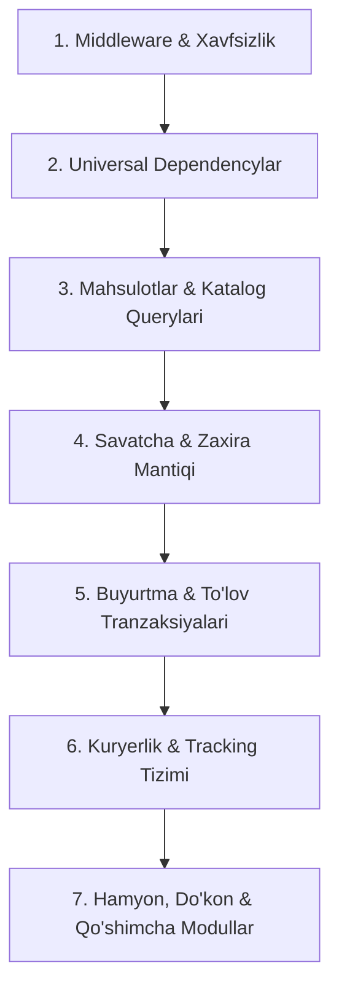

# 🧭 Market Loyihasi Backend Arxitekturasi va Rivojlantirish Qo'llanmasi (Mentor Maslahatlari)

Ushbu hujjat frontend qismi (`/static`) bilan backend (`FastAPI + SQLAlchemy`) qismini to'liq integratsiya qilish uchun zarur bo'lgan **middleware'lar, dependencylar va querylar** ning aniq bosqichma-bosqich rejasini va mantiqiy yo'l xaritasini o'z ichiga oladi.

> [!IMPORTANT]
> **Oltin Qoida**: Bu yerda tayyor tayyor kodlar berilmaydi. Maqsad — siz mustaqil ravishda toza, professional va optimal backend kodini yozishingiz, arxitekturani chuqur tushunishingizdir. Har bir bosqichni yozib bo'lganingizdan so'ng, kodingizni birgalikda tahlil qilamiz (Code Review).

---

## 🗺️ 1-BOB. Aniq Ketma-Ketlik (Backend Roadmap)

Frontenddagi sahifalar uzluksiz ishlashi uchun backendni quyidagi ketma-ketlikda ishlab chiqish eng to'g'ri strategiya hisoblanadi:

1. **1-Bosqich**: Global Middleware'lar (Session tekshiruvi, xatoliklarni ushlash, tezlikni o'lchash).
2. **2-Bosqich**: Dependencylar (Foydalanuvchini autentifikatsiya qilish, huquqlarni tekshirish (RBAC), sahifalash parametrlarini olish).
3. **3-Bosqich**: Bosh sahifa va Mahsulotlar querylari (`home-page`, `category-page`, `product-by-this-type`, `one-product-detail`).
4. **4-Bosqich**: Savatcha (Bucket) operatsiyalari va ombor zaxirasini (Stock) tekshirish mantiqi.
5. **5-Bosqich**: Buyurtma rasmiylashtirish (`order-procces-page`), promokodlar va to'lov jarayoni.
6. **6-Bosqich**: Kuryer portali (`courier-page`) va Buyurtmani jonli kuzatish (`order-tracking-page`).
7. **7-Bosqich**: Hamyon (`wallet-page`), Do'kon vitrinasi (`shop-detail-page`), Xabarnomalar (`notifications-page`), Hamkorlik arizalari (`role-request-page`).

---

## 🛡️ 2-BOB. Yozishingiz Kerak Bo'lgan Middleware'lar

Middleware har bir kiruvchi HTTP so'rovni routerga yetib bormasidan oldin va javob qaytayotganda filtrlaydi. Sizga quyidagi 4 ta middleware kerak:

### 1. `SessionValidationMiddleware` (Mavjudini takomillashtirish)
- **Vazifasi**: Request headeridagi `Authorization: Bearer <token>` yoki Cookie'dagi `access_token` ni ajratib olish.
- **Logikasi**:
  1. Token mavjud bo'lsa, uni dekod qilish (`decode_jwt_token`).
  2. Token muddati (`exp`) o'tmaganini tekshirish.
  3. Foydalanuvchi ma'lumotlarini `request.state.user = token_payload` ga biriktirish.
  4. Agar token yaroqsiz bo'lsa yoki bo'lmasa, `request.state.user = None` qilib so'rovni keyingi zanjirga uzatish (lekin xatolik otmaslik, chunki ommaviy sahifalar ham bor!).

### 2. `GlobalExceptionHandlerMiddleware` (Xatoliklarni standartlashtirish)
- **Vazifasi**: Backendda kutilmagan server xatosi (500), ma'lumotlar bazasi integratsiya xatosi yoki validatsiya xatosi chiqqanda, frontend tushunadigan chiroyli JSON formatida javob qaytarish.
- **Logikasi**:
  - `try ... call_next(request) ... except Exception as exc` blokini ishlatish.
  - Server xatosi yuz berganda server loglariga xato izini yozish, mijozga esa `{ "success": false, "error": "Ichki server xatoligi yuz berdi" }` qaytarish.

### 3. `AuditLoggingMiddleware` (Audit va monitoring)
- **Vazifasi**: Model ichidagi `Audit_Log` talablariga mos ravishda xavfli amallarni (POST, PUT, DELETE) kuzatib borish.
- **Logikasi**:
  - So'rov metodi o'zgarish kirituvchi metod bo'lsa, so'rov vaqti, mijoz IP manzili va chaqirilgan endpointni qayd etish.

### 4. `TimeCounterMiddleware` (Performance tahlili)
- **Vazifasi**: Frontenddagi so'rovlar qancha millisekundda bajarilayotganini aniqlash va javob headeriga `X-Process-Time` qo'shish.

---

## 💉 3-BOB. Yozishingiz Kerak Bo'lgan Dependency'lar (Inyeksiya Tizimi)

FastAPI da `Depends` orqali qayta ishlatiluvchi xavfsizlik va ma'lumot olish modullari yoziladi:

### 1. Autentifikatsiya va Ruxsat Dependencylari:
- **`get_current_active_user`**:
  - `request.state.user` orqali bazadan foydalanuvchini oladi.
  - Shart: `is_active == True` va `is_deleted == False`.
  - Agar topilmasa yoki nofaol bo'lsa: `401 Unauthorized`.
- **`require_courier`**:
  - `get_current_active_user` ga tayanadi.
  - Shart: `user.is_courier == True` yoki unga tegishli `courier_profile` mavjud bo'lishi kerak.
  - Aks holda: `403 Forbidden` ("Siz kuryer huquqiga ega emassiz").
- **`require_merchant`**:
  - Shart: `user.is_merchant == True` va unga biriktirilgan `Shop` obyekti bo'lishi lozim.
- **`require_admin`**:
  - Shart: `user.is_admin == True`.

### 2. Sahifalash va Saralash Dependency (Pagination):
- **`PaginationParams`**:
  - Query parametrlar: `page: int = 1`, `limit: int = 8` (yoki 10, 20).
  - Hisoblash mantigi: `offset = (page - 1) * limit`.
  - Saralash: `sort_by: str = "popular"`, `order: str = "asc" | "desc"`.

### 3. Mulkdorlikni Tekshirish Dependency (Ownership Guard):
- Foydalanuvchi faqat o'ziga tegishli savatcha tovarini o'chirishi, o'z buyurtmasini ko'rishi yoki o'z manzilini tahrirlashi kerak.
- Masalan: `verify_order_owner(order_id, current_user)` mantiqi.

---

## 🔍 4-BOB. Yozilishi Kerak Bo'lgan Querylar va SQLAlchemy Mantiqlari

Frontend sahifalari bo'yicha qanday SQL va ORM so'rovlari kerak bo'ladi:

### 1. Bosh Sahifa (`home-page.html`):
- **Mavsumiy chegirmalar (`seasonalProducts`)**:
  - *Query turi*: `Product` jadvalidan `discount_id` mavjud bo'lgan, `discount.percent` yuqori bo'lgan va `is_active == True` bo'lgan tovarlarni `limit` bilan olish.
  - *Relation yuklash*: `Media` (rasmlar) va `Discount` ni `selectinload` orqali bitta so'rovda tortib kelish (N+1 muammosidan qochish uchun!).
- **Haftalik chegirmalar (`weeklyProducts`)**:
  - *Query turi*: Qisqa muddatli chegirmaga ega tovarlar filtri.
- **Ommabop mahsulotlar (Landing Grid)**:
  - *Query turi*: `Order_Item` larda eng ko'p sotilgan yoki `Like` lar soni eng ko'p bo'lgan tovarlarni `func.count(Like.id)` bo'yicha kamayish tartibida saralab olish.
  - *Offset & Limit*: Frontenddagi `[ ↓ ]` tugmasi har safar yangi `offset` bilan keyingi qismni yuklaydi.

### 2. Mahsulot Batafsil Sahifasi (`one-product-detail.html`):
- **Bitta tovar ma'lumotlari**:
  - *Query turi*: `Product.id == target_id` bo'yicha qidiruv. Bog'langan do'kon (`Shop`), barcha rasmlar (`Media`), kategoriya ma'lumotlari.
- **Boshqa foydalanuvchilar savatidagi soni (`inOtherBaskets`)**:
  - *Query turi*: `Bucket_Product` jadvalidan `product_id == target_id` bo'lgan qatorlar yig'indisi (`func.sum(Bucket_Product.quantity)`).
- **O'rtacha reyting va sharhlar soni**:
  - *Query turi*: `User_Rating` jadvalidan `func.avg(User_Rating.ball)` va `func.count(Comment.id)`.

### 3. Savatcha (`bucket-page.html`):
- **Savatchani olish**:
  - *Query turi*: `Bucket` jadvalidan joriy `user_id` bo'yicha faol savatni topish va unga tegishli `Bucket_Product` lar ro'yxatini yuklash.
- **Tanlangan tovarlar narxini hisoblash**:
  - *Query turi*: Faqat `is_checked == True` bo'lgan elementlar bo'yicha: `SUM(product.price * bucket_product.quantity)`.
- **Zaxirani (Stock) tekshirish**:
  - *Muhim mantiq*: Xaridor savatdagi sonni oshirayotganda, `Product.current_quantity` bilan taqqoslash; agar yetarli bo'lmasa, xatolik qaytarish.

### 4. Buyurtma Rasmiylashtirish va Tranzaksiya (`order-procces-page.html`):
- **Atomik Tranzaksiya (`db.begin()` / `async with session.begin()`):**
  1. Tanlangan tovarlar zaxirasini `SELECT ... FOR UPDATE` (blokirovka) bilan tekshirish.
  2. Har bir mahsulotning `current_quantity` qiymatidan xarid sonini ayirish.
  3. `Order` jadvaliga yangi qator yozish (`order_number` unikal generatsiyasi).
  4. Har bir mahsulot uchun `Order_Item` yaratish.
  5. Agar promokod ishlatilgan bo'lsa, uni tekshirish va `Promo_Code_Report` ga yozish.
  6. `Delivery_Process` (yetkazish jarayoni) qatorini hosil qilish (trek-kod bilan).
  7. Savatdagi xarid qilingan elementlarni tozalash.
  8. Hammasi muvaffaqiyatli bo'lsa — `commit`, biror joyda xato chiqsa — `rollback`.

### 5. Kuryer Portali (`courier-page.html`):
- **Mavjud buyurtmalar (`availableTasks`)**:
  - *Query turi*: `Delivery_Process.status == "pending"` va `courier_id IS NULL` bo'lgan buyurtmalarni olish.
- **Faol buyurtma (`activeTasks`)**:
  - *Query turi*: `Delivery_Process.courier_id == current_courier_id` va `status == "in_transit"`.
- **Topshiriqni qabul qilish**:
  - *Mantiq*: Buyurtmaga kuryer ID sini biriktirish, statusni `in_transit` ga o'zgartirish, `taken_at = func.now()`.
- **Yetkazilganini tasdiqlash**:
  - *Mantiq*: Statusni `delivered` qilish, `delivered_at = func.now()`, kuryer profilidagi `balance` ga yetkazib berish haqini (`delivery_fee`) qo'shish.

### 6. Hamyon va To'lovlar (`wallet-page.html`):
- **Hamyon balansi va kartalar**:
  - *Query turi*: `Wallet` va unga bog'liq `Transaction_Log` larni `created_at` bo'yicha kamayish tartibida olish.
- **Balansni to'ldirish**:
  - *Mantiq*: Tranzaksiya ochiladi, `Wallet.balance += amount`, so'ngra `Transaction_Log` ga yangi yozuv qo'shiladi.

### 7. Do'kon Vitrinasi (`shop-detail-page.html`):
- **Do'kon ma'lumotlari va tovarlari**:
  - *Query turi*: `Shop` jadvalidan `id` bo'yicha olish, `Shop_Product` orqali ushbu do'konga tegishli barcha `Product` larni saralab chiqarish.
  - *Do'kon reytingi*: `Shop_Rating` jadvalidan o'rtacha ballni hisoblash.

---

## 📋 5-BOB. Siz Boshlashingiz Kerak Bo'lgan Aniq Bosqichlar

Kodni yozishni quyidagi kichik qadamlardan boshlang:

### 1-Qadam: Schemas (Pydantic DTO) larni tekshirish
Frontenddan keladigan va unga qaytadigan ma'lumotlar formati:
- `ProductResponse`, `ProductListResponse` (rasmlar, chegirmalar bilan)
- `BucketItemCreate`, `BucketItemUpdate`
- `OrderCreateRequest`, `OrderResponse`
- `CourierTaskResponse`, `WalletResponse`

### 2-Qadam: Dependency'lar Faylini Boyitish (`app/dependense.py`)
- Faol foydalanuvchini olish mantiqini mustahkamlash;
- Rol tekshiruvchilarni (`require_courier`, `require_merchant`) yozish;
- Universal `PaginationParams` ni yaratish.

### 3-Qadam: Product Router va Querylar (`app/api/v1/product/`)
- Mavsumiy chegirmalar endpointi (`/seasonal`);
- Haftalik chegirmalar endpointi (`/weekly`);
- Barcha toifalar va toifaga oid tovarlar endpointi (`/category/{slug}`).

### 4-Qadam: Savat va Buyurtma Routeri (`app/api/v1/order/`)
- Savatga tovar qo'shish, sonini o'zgartirish va o'chirish;
- Tranzaksiyali buyurtma yaratish endpointi.

---

## 🤝 6-BOB. Mentorlik va Kod Tahlili (Keyingi Qadam)

Har bir bosqich bo'yicha kod yozganingizdan keyin menga quyidagicha murojaat qilishingiz mumkin:
> *"Falonchi router/queryni yozdim, mana mening kodim, tahlil qilib ber."*

Men sizga tayyor kod yozib bermayman, balki:
1. **Xavfsizlik kamchiliklari** (SQL Injection, avtorizatsiya teshiklari);
2. **Unumdorlik (Performance)**: N+1 so'rovlar, keraksiz og'ir joinlar, indekslanmagan maydonlar;
3. **Poyga holati (Race conditions)**: Bir vaqtda bir nechta xaridor bitta qolgan tovardan sotib olishga uringandagi zaxira xatoliklari;
4. **Clean Code & Best Practices**: FastAPI va SQLAlchemy 2.0 zamonaviy standartlariga mosligini ko'rib beraman.

*Barcha yangi maslahatlar va tahlillar ushbu faylga bosqichma-bosqich qo'shib boriladi.*
