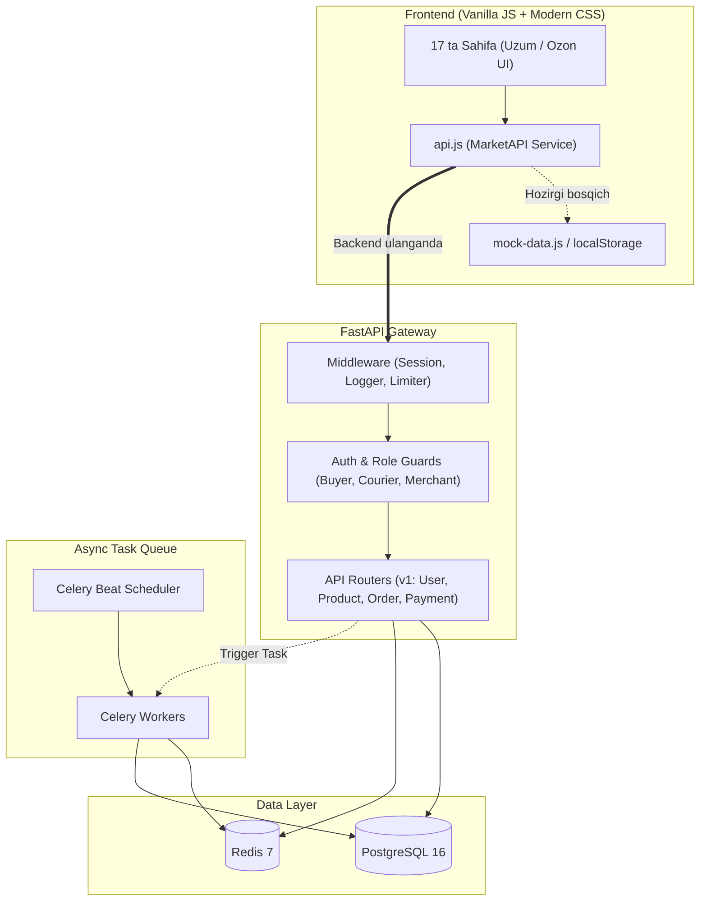

# 🛒 Multi-Vendor Market Platform (Uzum / Ozon Analog)

Zamonaviy, yuqori yuklamalarga mo'ljallangan va to'liq asinxron **Multi-Vendor E-Commerce & Logistics Platform**. Ushbu loyiha **Uzum Market** va **Ozon** kabi yirik marketpleyslar andozasida yaratilgan bo'lib, xaridorlar, sotuvchilar (merchantlar) va kuryerlar uchun yagona ekotizimni taqdim etadi.

---

## 📌 Loyiha Haqida va Asosiy Maqsad

Loyiha O'zbekiston elektron tijorat bozori talablariga to'liq javob beruvchi, xaridor mahsulotni tanlashidan boshlab to kuryer eshikkacha yetkazib berguniga qadar bo'lgan to'liq zanjirni avtomatlashtirishga qaratilgan.

### 👥 3 Asosiy Foydalanuvchi Roli:
1. **Xaridor (Buyer)**: Mahsulotlar qidiruvi, saralash, mavsumiy va haftalik chegirmalar, faqat belgilangan tovarlarni savatdan xarid qilish, promokodlar, muddatli to'lov (nasiya), buyurtmani trek-kod orqali 5 bosqichda jonli kuzatish, shaxsiy hamyon (Uzcard/Humo/Visa).
2. **Sotuvchi (Merchant / Shop)**: Shaxsiy do'kon vitrinasi, brend banneri, mahsulotlar va ombor qoldig'i (stock) boshqaruvi, do'kon reytingi va xaridorlar sharhlarini monitoring qilish.
3. **Kuryer (Courier - Uzum Tezkor analogi)**: Onlayn/Oflayn ish rejimi, transport turini tanlash (*Piyoda, Velosiped, Skuter, Avtomobil*), yaqin atrofdagi buyurtmalarni qabul qilish, bosqichma-bosqich yetkazib berish va kunlik daromad / balansni kartaga chiqarish.

---

## 🛠️ Texnologik Stek (Tech Stack)

Loyiha eng so'nggi va barqaror texnologiyalar ustiga qurilgan:

### 🐍 Backend & Asinxron Tizim
- **Python 3.12+**: Zamonaviy turdagi tiplash va unumdorlik.
- **FastAPI**: Yuqori tezlikka ega asinxron RESTful API arxitekturasi.
- **SQLAlchemy 2.0 (Asyncio)**: Declarative Mapped modellar, `selectinload` va `joinedload` orqali N+1 muammolarisiz ma'lumotlar almashinuvi.
- **PostgreSQL 16**: Relatsion ishonchli ma'lumotlar bazasi (ACID tranzaksiyalari bilan).
- **Alembic**: Ma'lumotlar bazasi migratsiyalarini avtomatlashtirish.
- **Celery & Celery Beat**: Asinxron fon vazifalari (bildirishnomalar, muddati o'tgan buyurtmalarni tozalash, avtomatik hisobotlar).
- **Redis 7**: Kesh tizimi, Celery brokeri va so'rovlar tezligini cheklovchi (Rate Limiter).
- **SlowAPI**: DDOS va brute-force hujumlaridan himoyalovchi tezkor Rate Limiting.
- **Starlette Admin**: Ma'lumotlar bazasini qulay boshqarish uchun o'rnatilgan boshqaruv paneli.
- **Xavfsizlik**: JWT (`python-jose`), `Argon2-cffi` va `passlib` orqali kuchli parollarni shifrlash, `zxcvbn` parol mustahkamligini baholash.

### 🎨 Frontend Qismi
- **Arxitektura**: Toza Vanilla JavaScript (ES6+ modullari, `MarketAPI` abstraksiyasi, `localStorage` asosidagi sahifalararo uzluksiz sinxronizatsiya).
- **Dizayn Tizimi**: Uzum binafsha (`#7000FF`) va Ozon moviy (`#005BFF`) ranglar uyg'unligi, CSS Custom Properties (Variables), Flexbox & Grid, to'liq moslashuvchan (Responsive) interfeys.
- **UX/UI**: Rasm karusellari, miqdor hisoblagich (- 0 +), dinamik baholash modallari, Toast bildirishnomalar, `< 1 >` pagination va `[ ↓ ]` landing page scroll / load more.

### 🐳 DevOps & Deploy
- **Docker & Docker Compose**: PostgreSQL, Redis, FastAPI, Celery Worker va Celery Beat konteynerlari orqali bir tugma bilan to'liq orkestratsiya.
- **UV**: Tezkor Python dependency menejeri.

---

## 🏛️ Tizim Arxitekturasi



---

## 📂 Sahifalar Xaritasi (`/static`)

Frontend quyidagi 17 ta to'liq ishlab turgan sahifalardan iborat:

| Sahifa | Fayl | Qisqacha Tavsif |
| :--- | :--- | :--- |
| **Bosh sahifa** | `home-page.html` | Mavsumiy chegirmalar, Haftalik chegirmalar karuseli, Ommabop tovarlar gridi, `[ ↓ ]` Load More. |
| **Savatcha** | `bucket-page.html` | Faqat tanlangan tovarlar jami summasini hisoblash, miqdor boshqaruvi, `TO BUY` tugmasi. |
| **Mahsulot sahifasi** | `one-product-detail.html` | Katta suratlar karuseli, ombor qoldig'i, reyting, do'kon havolasi, savatga qo'shish, tavsif. |
| **Sharhlar** | `one-product-comments.html` | Xaridorlar fotosuratlari, baholar, sharhlar va `< 1 >` chap\|o'ng sahifalash. |
| **Toifalar bo'yicha** | `product-by-this-type.html` | 3x3 formatdagi mahsulotlar gridi, filter-chiplar, saralash va `< 1 >` pagination. |
| **Buyurtma berish** | `order-procces-page.html` | PVZ / Kuryer tanlovi, to'lov usullari (Karta, Naqd, Nasiya), promokod hisobi, `BUY`. |
| **Buyurtmalarim** | `ordered-product-page.html` | Buyurtmalar tarixi, statuslar (*Kuryer yo'lda, Yetkazildi*), unikal ID, kuzatuv tugmasi. |
| **Buyurtmani kuzatish** | `order-tracking-page.html` | Trek-kod bo'yicha 5 bosqichli jonli kuzatuv, mas'ul kuryer va yetib borish vaqti. |
| **Kuryer portali** | `courier-page.html` | Uzum Tezkor analogi: Onlayn/Oflayn, transport tanlash, yangi buyurtmalarni qabul qilish. |
| **Shaxsiy kabinet** | `account-page.html` | Foydalanuvchi ma'lumotlari, 9 ta kontekstli sidebar menyulari, "I'm courier" integratsiyasi. |
| **Hamyon** | `wallet-page.html` | Hamyon balansi, Uzcard/Humo/Visa kartalarini ulash, to'ldirish va tranzaksiyalar tarixi. |
| **Do'kon vitrinasi** | `shop-detail-page.html` | Sotuvchi do'koni banneri, reytingi, tovarlari va xaridorlar tomonidan baho berish. |
| **Xabarnomalar** | `notifications-page.html` | Buyurtma statusi o'zgarishi, chegirmalar va tizim xabarlari jurnali. |
| **Hamkorlik arizalari** | `role-request-page.html` | Do'kon ochish (Merchant) yoki Kuryer bo'lish uchun ariza va rezyume topshirish portali. |
| **Sevimlilar** | `liked-page.html` | Xaridor yoqtirgan (♥) mahsulotlar kolleksiyasi. |
| **Katalog** | `category-page.html` | Barcha asosiy va ichki subkategoriyalar daraxti. |
| **Chat** | `chatting-with-buyer.html` | Xaridor, sotuvchi do'kon va kuryer o'rtasidagi to'g'ridan to'g'ri yozishmalar. |

---

## 🚀 O'rnatish va Ishga Tushirish (Quick Start)

### 1. Repozitoriyani klonlash va muhitni sozlash:
```bash
git clone https://github.com/your-username/market.git
cd market
```

### 2. Virtual muhitni faollashtirish va bog'liqliklarni o'rnatish:
```bash
# uv package manager orqali (tavsiya etiladi)
uv sync

# yoki standart pip orqali
python3 -m venv .venv
source .venv/bin/activate
pip install -r requirements.txt
```

### 3. `.env` faylini sozlash:
Loyiha ildizidagi `.env` faylida PostgreSQL, Redis va JWT maxfiy kalitlarini ko'rsating:
```env
DB_USER=postgres
DB_PASSWORD=your_password
DB_NAME=market_db
DB_HOST=localhost
DB_PORT=5432

REDIS_HOST=localhost
REDIS_PORT=6379

SECRET_KEY=your_super_secret_jwt_key
ALGORITHM=HS256
ACCESS_TOKEN_EXPIRE_MINUTES=1440
```

### 4. Ma'lumotlar bazasi migratsiyalari:
```bash
alembic upgrade head
```

### 5. Docker orqali barcha servislarni bir vaqtda ishga tushirish (Tavsiya etiladi):
```bash
docker-compose up --build -d
```
Ushbu buyruq avtomatik tarzda:
- PostgreSQL bazasini (`5432`);
- Redis kesh serverini (`6380:6379`);
- FastAPI asosiy serverini (`8000`);
- Celery ishchi konteynerini (`market_celery_worker`);
- Celery Beat rejalashtiruvchisini (`market_celery_beat`) ishga tushiradi.

---

## 🌐 Brauzerda Ishlatish

Server ishga tushgach, quyidagi manzillar orqali tizimdan foydalanishingiz mumkin:
- **Asosiy Market (Bosh sahifa)**: [http://127.0.0.1:8000/static/home-page.html](http://127.0.0.1:8000/static/home-page.html)
- **Kuryerlik Portali**: [http://127.0.0.1:8000/static/courier-page.html](http://127.0.0.1:8000/static/courier-page.html)
- **Shaxsiy Hamyon**: [http://127.0.0.1:8000/static/wallet-page.html](http://127.0.0.1:8000/static/wallet-page.html)
- **FastAPI Avtomatik Swagger Hujjatlari**: [http://127.0.0.1:8000/docs](http://127.0.0.1:8000/docs)
- **Admin Boshqaruv Paneli**: [http://127.0.0.1:8000/admin](http://127.0.0.1:8000/admin)

---

## 🔒 Xavfsizlik va Ma'lumotlar Butunligi

- **Concurreny & Race Conditions**: Savatdan xarid qilish vaqtida bir vaqtda kelgan so'rovlar uchun `SELECT ... FOR UPDATE` blokirovkalari orqali ombor zaxirasining manfiy songa tushib ketishi oldi olingan.
- **RBAC (Role Based Access Control)**: Endpointlar foydalanuvchi maqomiga (`is_active`, `is_courier`, `is_merchant`, `is_admin`) ko'ra qat'iy himoyalangan.
- **Cascade Deletion Policy**: Tizimdan foydalanuvchi yoki do'kon o'chirilganda, bog'liq ma'lumotlar qoidalarga binoan arxivlanadi (`garbage_email`) yoki kaskadli tozalanadi.

---

## 👨‍💻 Muallif va Rivojlantirish

Loyiha arxitekturasi va backend yo'l xaritasi bo'yicha maslahatlar **[`GEMINI_adice.md`](file:///home/maxfull/Downloads/project/market/GEMINI_adice.md)** hujjatida yoritilgan.
Savollar va takliflar uchun GitHub Issues bo'limida murojaat qilishingiz mumkin.
